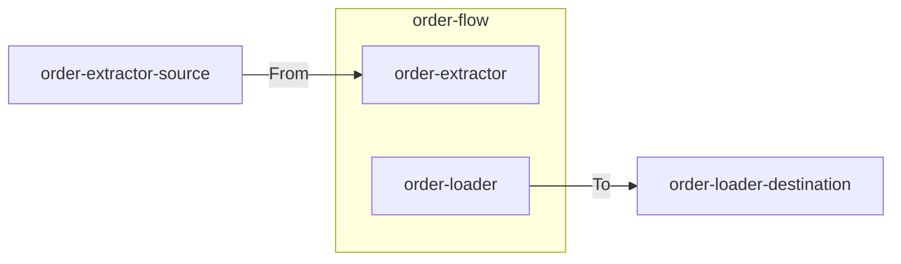

# Ports

> A port is the named port an edge block reaches the outside world through. A binding port (the default) materializes as exactly one Dapr binding component named after the port; an [external port](#external-ports) is reached through the component's own client and has no binding.

## How it works



Every edge block reaches the outside world through a port. A binding port runs through Dapr: it becomes exactly one Dapr binding component carrying the port's name, never declared separately.

The name is the port's **whole identity**. The binding's deployed `spec.type` — sftp, blob, http — together with its address and credentials, is environment-owned deployment configuration. The topology deliberately does not repeat it: a fact deployment owns and can edit would drift from a second copy declared here, and a drifting topology is an untrusted one. Locally, F5 runs substitute their own resolution through the development definition (every binding port resolves to a localstorage folder), so the system runs with zero external configuration.

## Declaring ports

Ports are declared as static fields in a scaffolded `Ports.cs`. They are system-owned and never shared across systems:

```csharp
public static class Ports
{
    public static readonly PortRef OrderExtractorSource =
        PortRef.Define("order-extractor-source");

    public static readonly PortRef OrderLoaderDestination =
        PortRef.Define("order-loader-destination");
}
```

Direction is not part of a port's identity — it follows from usage: `From(port)` reads, `To(port)` writes. Because the name is the identity, two declarations with the same name are the same port by construction; there is nothing left to conflict.

## External ports

Some systems are not reached through a binding: a database the component queries or writes, an HTTP API it pages through. Declare such a port with `PortRef.DefineExternal`. The component reaches it through a client or adapter of its own, configured from the port's section, `Ports:<port>`:

```csharp
public static class Ports
{
    public static readonly PortRef CampaignDb = PortRef.DefineExternal("campaign-db");
    public static readonly PortRef CrmDb = PortRef.DefineExternal("crm-db");
}

builder.AddExtractor("campaign-extractor")
    .From(Ports.CampaignDb)          // reads, keeping a cursor between runs
    .Publishes(Messages.Campaigns);

builder.AddLoader("campaign-loader")
    .Subscribes(Messages.Campaigns)
    .To(Ports.CrmDb);                // writes; no cursor
```

- **No binding.** Generation renders no Dapr binding for an external port, and the component config marks the port `"Kind": "External"` instead of naming a Dapr component.
- **A cursor store for readers.** A component that reads an external port (`From`) gets a Dapr state store of its own, `<component>-cursors`, recorded as the component's `CursorStore` and passed to it as `Ports__<port>__CursorStore`. A component that only writes to one gets none.
- **Read, written, or both.** Direction still follows from usage; one external system can be read by one component and written by another.
- **One kind per port.** Declaring the same name with both `PortRef.Define` and `PortRef.DefineExternal` is a validation error.

Locally, an external port has no folder or mock. Its values (a connection string, a base URL) come from the development definition and reach every component that reads or writes it as `Ports__<port>__<key>`; they are never written into generated artifacts:

```csharp
development.Settings(Ports.CampaignDb)
    .Set("ConnectionString", "Server=localhost,1433;Database=Campaigns;...");
```

`CursorStore` is reserved: the host sets it for readers.

## Materialized ports

Each used port folds into a `PortResource` carrying the Dapr component name, its kind, the union of used directions, and the components using it. `Kind` is omitted from the serialized model for a binding port, so systems without external ports serialize unchanged:

```csharp
public sealed record PortResource
{
    public required string Name { get; init; }
    public string DaprComponentName => Name;
    public PortKind Kind { get; init; }      // Binding (default) or External
    public required IReadOnlyList<PortDirection> Directions { get; init; }
    public required IReadOnlyList<string> UsedBy { get; init; }
}
```

## Related

- [Validation](validation.md) — name collisions and usage rules
